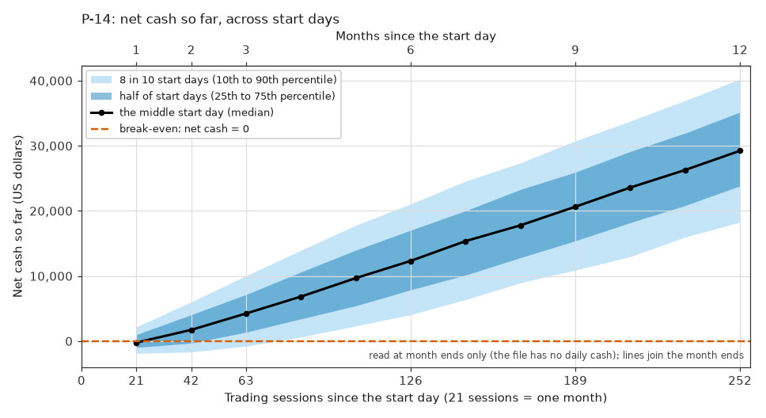
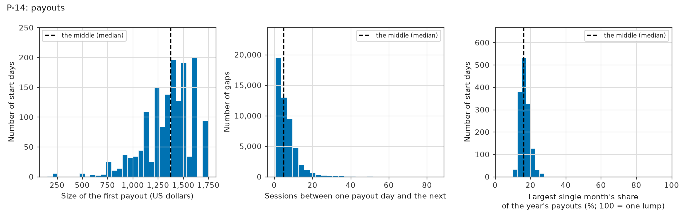
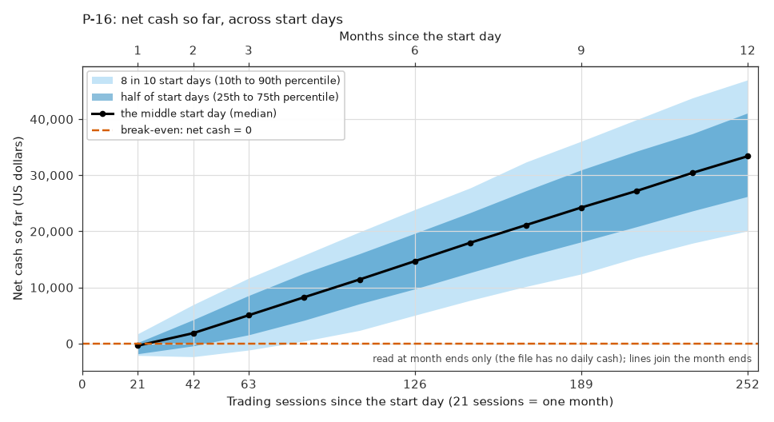
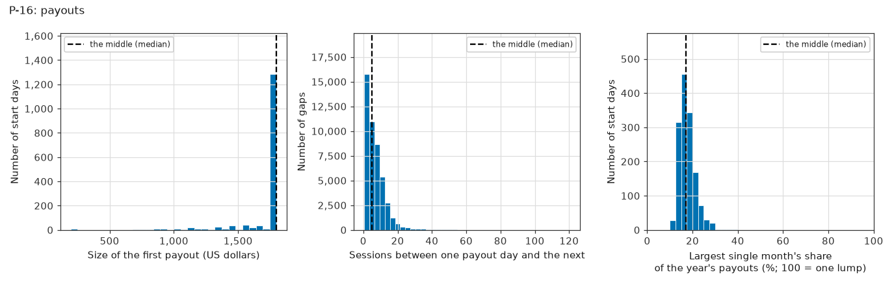
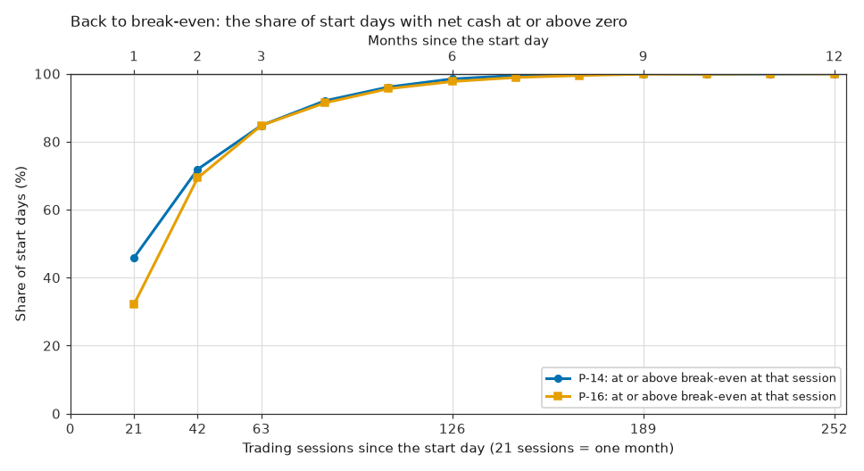
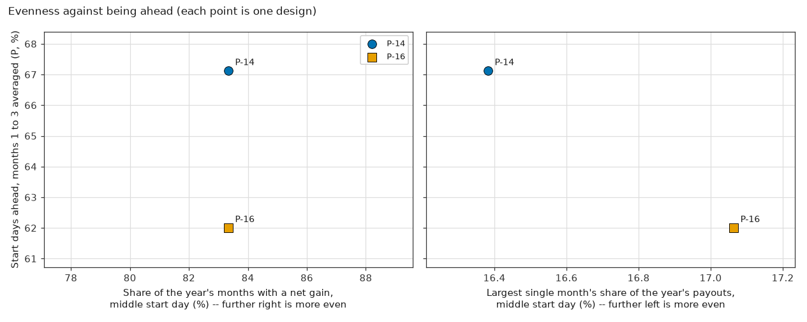

# Demonstration: how spread out a user's journey is -- P-14 and P-16 on Stage 2's U1 file

> **DEMONSTRATION on Stage 2's file.** This page shows how the report reads a result file. Its figures are computed from the start rows already in that file; no result of this repository is on it, and nothing is chosen from it.
>
> **EXPLORATORY.** The file's manifest marks it exploratory: its readings were not declared as a test before they were run. They are reported apart from any declared result and decide nothing.

**Source.** `vendor/stage2/results/user_journey.csv`, its rows where section = start; the manifest checked before reading (sha256 `5c8e7413767b`); written by `scripts/user_journey.py` at commit `d39d9968624a` on 2026-11-14; no declaration named; variant count in its manifest: 18.
**Built by** `python scripts/build_report.py --report demo_stage2_u1` (`extended/report.py`). The page is rebuilt from the file, never edited by hand.

Stage 2's U1 file holds each start day's first pass and first payout, the cash before each and the month-end nets and fees; it has no daily cash and no payout one by one, so the measures that need them are shown as "not in this file". The as-traded (point) arm is in the same file and not shown: the charter judges on the cautious reading. This repository's own file of these readings is Q-17's (`results/user_beside.csv`, not yet written).

## How to read this page

- **A start day** is one simulated user who begins on that trading day with fresh accounts; the design's trades are replayed in historical order. Every figure is a spread across start days -- what different users would have lived -- not one user's luck.
- **Net cash** is payouts received less every fee paid, so far. **Ahead** means net cash above zero; **break-even** means net cash back to zero or above.
- **Low end, middle, high end** are the 10th percentile, the median and the 90th percentile across start days: one start day in ten is at or below the low end, half are below the middle, one in ten is at or above the high end. For sessions and cash spent, the high end is the slow, expensive tenth; for net cash, the low end is the unlucky tenth.
- A **month** is 21 trading sessions; the year is 252. A figure read at a month reads only the start days with that much history after them, so later start days drop out of the later figures.
- **The cautious reading** (Stage 2's verdict arm): every trade's result moved down to the one-sided 95 % lower bound of what its history supports -- the reading the charter judges on.
- **Start days overlap.** Two start days a week apart share most of their trades, so a thousand start days are far fewer independent histories. "Separate stretches" divides the start days read by the sessions each one spans: a rough count of non-overlapping histories behind the figure.

## What this page does not model

Not modelled (CHARTER section 2): a user who stops when their own money runs out -- the replay keeps paying fees, so there is no ruin figure; the user's time; taxes.

Assumed, as Stage 2's engine models them: payouts never denied in every figure outside the denial ladder (Stage 2 D-234); the firm's Responsible Trading placement off (Stage 2 D-289); fills, the payout lag and the spacing of payouts as the engine models them, not as observed; the firm's rules as Stage 2's verified ledger holds them (`vendor/stage2/config/rules.yaml`).

## Not on this page

- the frontier of designs on P, S1, S3a and S5a, and the menu read under limits on what a user feels (the limits are not yet approved: E-015 (2));
- Stage 2's long-run gate (growth on the required bankroll at the bound): it is in each design's gate file;
- each figure's uncertainty from the effective number of independent starts, and the share of a result that is the start day's luck rather than the design (Q-17's readings).

## Not in this file

- **the daily net cash** (column `net_by_session`): sessions to break-even, the share that falls back below it, the deepest fall after it and the session-by-session curves are shown as "not in this file"; the net-cash bands and the break-even curve are read at month ends only;
- **each payout's cash** (column `pay_cash`): the size of every payout is not shown, only the first payout's;
- **the payout-denial ladder: not in this file** (column `denial`): every figure has payouts never denied.

## P-14, the row to beat (R*): a breakout on half-hour bars, five Topstep accounts -- the cautious reading

1,691 start days, 2020-01-02 to 2026-07-16. Each figure reads the start days with enough sessions left for it ("read over").

### The journey, start day by start day

| What it measures | Low end (p10) | Middle (median) | High end (p90) | Start days read | Separate stretches (about) | Read over |
|---|---:|---:|---:|---:|---:|---|
| Sessions until the first passed evaluation | 2 | 2 | 4 | 1,650 | 39.3 | start days with 42 sessions left (one not passed by then counts as later) |
| Cash out of pocket before the first pass ($) | 294 | 392 | 588 | 1,650 | 39.3 | start days that passed within 42 sessions |
| Sessions until the first payout arrives | 13 | 17 | 34 | 1,566 | 12.4 | start days with 126 sessions left (one not paid by then counts as later) |
| Cash out of pocket before the first payout ($) | 1,427 | 1,776 | 3,003 | 1,566 | 12.4 | start days paid within 126 sessions |
| Sessions until net cash is back to zero (break-even) | not in this file | not in this file | not in this file | not in this file | not in this file | start days with 252 sessions left (one not back by then counts as later) |
| Deepest fall in net cash after break-even ($) | not in this file | not in this file | not in this file | not in this file | not in this file | start days back to break-even within 252 sessions |
| Net cash at the end of month 3 ($) | -769 | 4,252 | 10,037 | 1,629 | 25.9 | start days with 63 sessions left |
| Net cash at the end of month 12 ($) | 18,273 | 29,235 | 40,234 | 1,440 | 5.7 | start days with 252 sessions left |
| Share of the year's months with a net gain | 66.7% | 83.3% | 91.7% | 1,440 | 5.7 | start days with 252 sessions left |
| Longest run of months without a payout (months) | 0.0 | 1.0 | 1.0 | 1,440 | 5.7 | start days with 252 sessions left |
| How much the monthly net change swings (standard deviation, $) | 1,853 | 2,448 | 3,132 | 1,440 | 5.7 | start days with 252 sessions left |
| Payouts per month | 2.58 | 3.33 | 4.00 | 1,440 | 5.7 | start days with 252 sessions left |
| Largest single month's share of the year's payouts | 13.6% | 16.4% | 20.3% | 1,440 | 5.7 | start days paid in the year (252 sessions left) |

*"After session h": more than a tenth (or half) of the start days had not got there within h sessions. "None to read": no start day to read.*

### The same on the judged block

The judged block is the start days from 2024-01-01 on (Stage 2 D-621 (4)(b)), the block a design is judged on: 657 of them. Its later start days have less history after them, so its longer readings rest on few separate stretches.

| What it measures | Low end (p10) | Middle (median) | High end (p90) | Start days read | Separate stretches (about) | Read over |
|---|---:|---:|---:|---:|---:|---|
| Sessions until the first passed evaluation | 2 | 2 | 3 | 616 | 14.7 | start days with 42 sessions left (one not passed by then counts as later) |
| Cash out of pocket before the first pass ($) | 294 | 392 | 588 | 616 | 14.7 | start days that passed within 42 sessions |
| Sessions until the first payout arrives | 13 | 17 | 24 | 532 | 4.2 | start days with 126 sessions left (one not paid by then counts as later) |
| Cash out of pocket before the first payout ($) | 1,478 | 1,725 | 2,463 | 532 | 4.2 | start days paid within 126 sessions |
| Sessions until net cash is back to zero (break-even) | not in this file | not in this file | not in this file | not in this file | not in this file | start days with 252 sessions left (one not back by then counts as later) |
| Deepest fall in net cash after break-even ($) | not in this file | not in this file | not in this file | not in this file | not in this file | start days back to break-even within 252 sessions |
| Net cash at the end of month 3 ($) | 106 | 4,623 | 9,325 | 595 | 9.4 | start days with 63 sessions left |
| Net cash at the end of month 12 ($) | 18,966 | 28,279 | 40,107 | 406 | 1.6 | start days with 252 sessions left |
| Share of the year's months with a net gain | 66.7% | 83.3% | 91.7% | 406 | 1.6 | start days with 252 sessions left |
| Longest run of months without a payout (months) | 0.0 | 1.0 | 1.0 | 406 | 1.6 | start days with 252 sessions left |
| How much the monthly net change swings (standard deviation, $) | 1,734 | 2,297 | 2,888 | 406 | 1.6 | start days with 252 sessions left |
| Payouts per month | 2.67 | 3.25 | 4.00 | 406 | 1.6 | start days with 252 sessions left |
| Largest single month's share of the year's payouts | 13.0% | 15.4% | 18.8% | 406 | 1.6 | start days paid in the year (252 sessions left) |

*"After session h": more than a tenth (or half) of the start days had not got there within h sessions. "None to read": no start day to read.*

### Month by month

| | Month 1 | Month 2 | Month 3 | Month 6 | Month 12 |
|---|---:|---:|---:|---:|---:|
| Ahead: net cash above zero | 45.8% | 71.9% | 84.8% | 98.5% | 100.0% |
| Paid at least once by then | 79.5% | 97.6% | 99.7% | 100.0% | 100.0% |
| Back to break-even at least once by then | not in this file | not in this file | not in this file | not in this file | not in this file |
| Start days read | 1,671 | 1,650 | 1,629 | 1,566 | 1,440 |

**P**, the share of start days ahead averaged over months 1, 2 and 3 on the same start days (the 1,629 with three months left): **67.1%**. It can differ a little from the mean of the first three shares above, which each read their own start days.

The share that falls back below zero after break-even: not in this file (it needs the daily net cash).

### The scorecard: P never alone

The primary measure P beside the guarded measures (CHARTER section 2), by Stage 2's own code (`u_select.scorecard`).

| Measure | What it is | All start days | Start days read | Judged block | Start days read | Better when |
|---|---|---:|---:|---:|---:|---|
| P | Start days ahead, averaged over months 1, 2 and 3 -- the primary measure | 67.1% | 1,629 | 71.9% | 595 | higher |
| S1 | Cash spent before the first payout, high end (p90): the bankroll a user needs | 3,003 | 1,566 | 2,463 | 532 | lower |
| S3a | Start days paid within a month (by session 21) | 79.5% | 1,671 | 85.2% | 637 | higher |
| S3b | Sessions to the first payout, high end (p90) | 34 | 1,566 | 24 | 532 | lower |
| S3c | Payouts received per dollar of fees by month 3, all start days pooled | 1.85 | 1,629 | 1.90 | 595 | higher |
| S4a | Start days ahead at month 6 | 98.5% | 1,566 | 99.6% | 532 | higher |
| S4b | Start days ahead at month 12 | 100.0% | 1,440 | 100.0% | 406 | higher |
| S5a | Net cash at month 3 of the unlucky tenth of start days (p10) | -769 | 1,629 | 106 | 595 | higher |
| S5b | Longest wait between payouts within 126 sessions, high end (p90) | 34.5 | 1,566 | 34.9 | 532 | lower |
| S5c | How concentrated month 6's money is: the best quarter of start days' share of the total | 41.9% | 1,566 | 40.5% | 532 | lower |

### Net cash over the first year

*Source: `vendor/stage2/results/user_journey.csv`, rows where section = start, config = p14, arm = verdict; sha256 `5c8e7413767b`, manifest checked before reading. Each point reads the start days with that many sessions left: 1,671 at month 1, 1,440 at month 12.*

### Payouts

| What | Low end (p10) | Middle (median) | High end (p90) | Read over |
|---|---:|---:|---:|---|
| Size of each payout ($) | not in this file | not in this file | not in this file | every one of the year's payouts |
| Size of the first payout ($) | 1,021 | 1,378 | 1,623 | 1,566 start days paid within 126 sessions |
| Payout cash received in a month, months with a payout ($) | 1,439 | 4,132 | 7,310 | 16,189 months with a payout, from 1,440 start days with 252 sessions left |
| Sessions between one payout day and the next | 1 | 5 | 12 | 51,701 gaps between payout days, from 1,440 start days with 252 sessions left |

*Payouts arriving on the same session count as one payout day for the gaps.*

*Source: `vendor/stage2/results/user_journey.csv`, rows where section = start, config = p14, arm = verdict; sha256 `5c8e7413767b`, manifest checked before reading.*

### Payout denial

The payout-denial ladder: not in this file. Every figure above has payouts never denied.

## P-16: a fair coin picks each trade's side (no signal), on wider stops -- the cautious reading

1,691 start days, 2020-01-02 to 2026-07-16. Each figure reads the start days with enough sessions left for it ("read over").

### The journey, start day by start day

| What it measures | Low end (p10) | Middle (median) | High end (p90) | Start days read | Separate stretches (about) | Read over |
|---|---:|---:|---:|---:|---:|---|
| Sessions until the first passed evaluation | 2 | 2 | 4 | 1,650 | 39.3 | start days with 42 sessions left (one not passed by then counts as later) |
| Cash out of pocket before the first pass ($) | 294 | 343 | 588 | 1,650 | 39.3 | start days that passed within 42 sessions |
| Sessions until the first payout arrives | 13 | 20 | 39 | 1,566 | 12.4 | start days with 126 sessions left (one not paid by then counts as later) |
| Cash out of pocket before the first payout ($) | 1,529 | 1,874 | 3,450 | 1,566 | 12.4 | start days paid within 126 sessions |
| Sessions until net cash is back to zero (break-even) | not in this file | not in this file | not in this file | not in this file | not in this file | start days with 252 sessions left (one not back by then counts as later) |
| Deepest fall in net cash after break-even ($) | not in this file | not in this file | not in this file | not in this file | not in this file | start days back to break-even within 252 sessions |
| Net cash at the end of month 3 ($) | -1,162 | 5,048 | 11,656 | 1,629 | 25.9 | start days with 63 sessions left |
| Net cash at the end of month 12 ($) | 20,081 | 33,396 | 46,998 | 1,440 | 5.7 | start days with 252 sessions left |
| Share of the year's months with a net gain | 66.7% | 83.3% | 91.7% | 1,440 | 5.7 | start days with 252 sessions left |
| Longest run of months without a payout (months) | 0.0 | 1.0 | 2.0 | 1,440 | 5.7 | start days with 252 sessions left |
| How much the monthly net change swings (standard deviation, $) | 2,019 | 2,795 | 3,538 | 1,440 | 5.7 | start days with 252 sessions left |
| Payouts per month | 2.17 | 3.00 | 3.75 | 1,440 | 5.7 | start days with 252 sessions left |
| Largest single month's share of the year's payouts | 13.8% | 17.1% | 22.3% | 1,440 | 5.7 | start days paid in the year (252 sessions left) |

*"After session h": more than a tenth (or half) of the start days had not got there within h sessions. "None to read": no start day to read.*

### The same on the judged block

The judged block is the start days from 2024-01-01 on (Stage 2 D-621 (4)(b)), the block a design is judged on: 657 of them. Its later start days have less history after them, so its longer readings rest on few separate stretches.

| What it measures | Low end (p10) | Middle (median) | High end (p90) | Start days read | Separate stretches (about) | Read over |
|---|---:|---:|---:|---:|---:|---|
| Sessions until the first passed evaluation | 2 | 2 | 4 | 616 | 14.7 | start days with 42 sessions left (one not passed by then counts as later) |
| Cash out of pocket before the first pass ($) | 294 | 392 | 637 | 616 | 14.7 | start days that passed within 42 sessions |
| Sessions until the first payout arrives | 13 | 19 | 41.9 | 532 | 4.2 | start days with 126 sessions left (one not paid by then counts as later) |
| Cash out of pocket before the first payout ($) | 1,576 | 1,898 | 3,599 | 532 | 4.2 | start days paid within 126 sessions |
| Sessions until net cash is back to zero (break-even) | not in this file | not in this file | not in this file | not in this file | not in this file | start days with 252 sessions left (one not back by then counts as later) |
| Deepest fall in net cash after break-even ($) | not in this file | not in this file | not in this file | not in this file | not in this file | start days back to break-even within 252 sessions |
| Net cash at the end of month 3 ($) | -1,416 | 4,920 | 11,977 | 595 | 9.4 | start days with 63 sessions left |
| Net cash at the end of month 12 ($) | 17,945 | 31,503 | 44,993 | 406 | 1.6 | start days with 252 sessions left |
| Share of the year's months with a net gain | 66.7% | 83.3% | 91.7% | 406 | 1.6 | start days with 252 sessions left |
| Longest run of months without a payout (months) | 0.0 | 1.0 | 2.0 | 406 | 1.6 | start days with 252 sessions left |
| How much the monthly net change swings (standard deviation, $) | 2,021 | 2,814 | 3,617 | 406 | 1.6 | start days with 252 sessions left |
| Payouts per month | 2.17 | 2.83 | 3.58 | 406 | 1.6 | start days with 252 sessions left |
| Largest single month's share of the year's payouts | 14.0% | 17.4% | 23.1% | 406 | 1.6 | start days paid in the year (252 sessions left) |

*"After session h": more than a tenth (or half) of the start days had not got there within h sessions. "None to read": no start day to read.*

### Month by month

| | Month 1 | Month 2 | Month 3 | Month 6 | Month 12 |
|---|---:|---:|---:|---:|---:|
| Ahead: net cash above zero | 32.1% | 69.3% | 84.8% | 97.7% | 99.9% |
| Paid at least once by then | 59.5% | 92.4% | 99.0% | 100.0% | 100.0% |
| Back to break-even at least once by then | not in this file | not in this file | not in this file | not in this file | not in this file |
| Start days read | 1,671 | 1,650 | 1,629 | 1,566 | 1,440 |

**P**, the share of start days ahead averaged over months 1, 2 and 3 on the same start days (the 1,629 with three months left): **62.0%**. It can differ a little from the mean of the first three shares above, which each read their own start days.

The share that falls back below zero after break-even: not in this file (it needs the daily net cash).

### The scorecard: P never alone

The primary measure P beside the guarded measures (CHARTER section 2), by Stage 2's own code (`u_select.scorecard`).

| Measure | What it is | All start days | Start days read | Judged block | Start days read | Better when |
|---|---|---:|---:|---:|---:|---|
| P | Start days ahead, averaged over months 1, 2 and 3 -- the primary measure | 62.0% | 1,629 | 61.6% | 595 | higher |
| S1 | Cash spent before the first payout, high end (p90): the bankroll a user needs | 3,450 | 1,566 | 3,599 | 532 | lower |
| S3a | Start days paid within a month (by session 21) | 59.5% | 1,671 | 60.9% | 637 | higher |
| S3b | Sessions to the first payout, high end (p90) | 39 | 1,566 | 41.9 | 532 | lower |
| S3c | Payouts received per dollar of fees by month 3, all start days pooled | 2.08 | 1,629 | 2.02 | 595 | higher |
| S4a | Start days ahead at month 6 | 97.7% | 1,566 | 96.8% | 532 | higher |
| S4b | Start days ahead at month 12 | 99.9% | 1,440 | 99.8% | 406 | higher |
| S5a | Net cash at month 3 of the unlucky tenth of start days (p10) | -1,162 | 1,629 | -1,416 | 595 | higher |
| S5b | Longest wait between payouts within 126 sessions, high end (p90) | 34 | 1,566 | 34 | 532 | lower |
| S5c | How concentrated month 6's money is: the best quarter of start days' share of the total | 40.7% | 1,566 | 41.1% | 532 | lower |

### Net cash over the first year

*Source: `vendor/stage2/results/user_journey.csv`, rows where section = start, config = p16, arm = verdict; sha256 `5c8e7413767b`, manifest checked before reading. Each point reads the start days with that many sessions left: 1,671 at month 1, 1,440 at month 12.*

### Payouts

| What | Low end (p10) | Middle (median) | High end (p90) | Read over |
|---|---:|---:|---:|---|
| Size of each payout ($) | not in this file | not in this file | not in this file | every one of the year's payouts |
| Size of the first payout ($) | 1,452 | 1,800 | 1,800 | 1,566 start days paid within 126 sessions |
| Payout cash received in a month, months with a payout ($) | 1,800 | 4,332 | 7,928 | 15,880 months with a payout, from 1,440 start days with 252 sessions left |
| Sessions between one payout day and the next | 1 | 5 | 13 | 46,590 gaps between payout days, from 1,440 start days with 252 sessions left |

*Payouts arriving on the same session count as one payout day for the gaps.*

*Source: `vendor/stage2/results/user_journey.csv`, rows where section = start, config = p16, arm = verdict; sha256 `5c8e7413767b`, manifest checked before reading.*

### Payout denial

The payout-denial ladder: not in this file. Every figure above has payouts never denied.

## The designs side by side

### Back to break-even

*Source: `vendor/stage2/results/user_journey.csv`, rows where section = start; sha256 `5c8e7413767b`, manifest checked before reading.*

The solid lines: the share of start days at or above break-even at that session. Read at month ends only: the file has no daily net cash.

### Evenness against being ahead

*Source: `vendor/stage2/results/user_journey.csv`, rows where section = start; sha256 `5c8e7413767b`, manifest checked before reading.*

Each point is one design. Higher is more start days ahead (P). On the left, further right is a more even path (more of the year's months with a net gain); on the right, further left is more even (a smaller largest month). The chart shows the trade-off; it does not choose: designs are compared by limits first, then the best inside them, with the limits approved by the operator (E-015).

## How the numbers on this page are kept honest

Every number above is computed from the source file when the page is built and registered in `extended/trace.py`; `python scripts/trace_check.py` recomputes each one from the file, after checking its manifest, and finds it on this page. Dates and the manifest's identifiers are provenance, not results.
