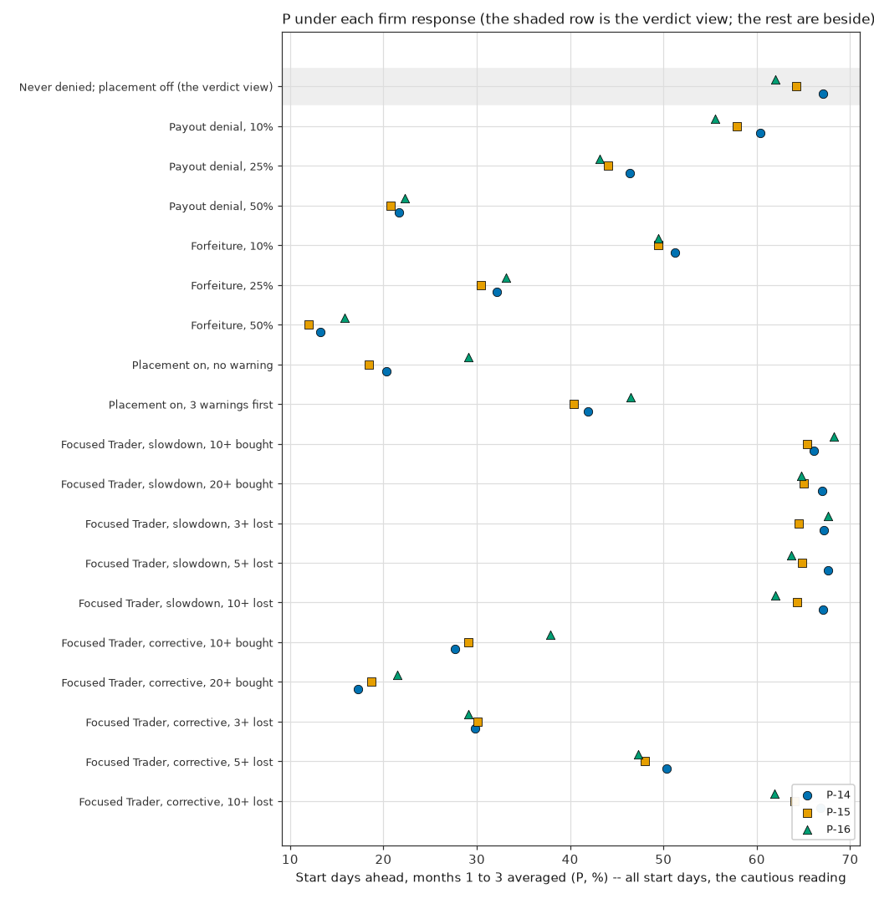
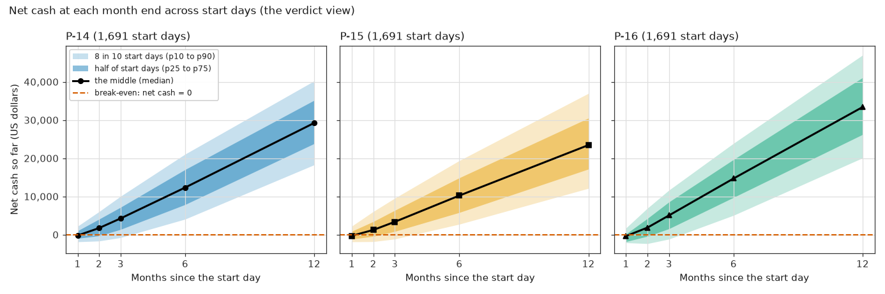

# The user's journey, start day by start day: P-14, P-15 and P-16, and the firm's responses beside

> **BESIDE, NEVER DECIDING.** A design passes only on its own trades: their lift over the coin twin, by a calibrated statistic (CHARTER section 3, E-008). This page is the user scorecard reported beside that judgement -- nothing on it passes or fails a design, and nothing is chosen from it. R* (the row to beat on P) stays P-14.
>
> **EXPLORATORY.** The file's manifest marks it exploratory: its readings were not declared as a test before they were run. They are reported apart from any declared result and decide nothing.

**Source.** `results/user_beside.csv` (sha256 `5ad0153d0747`) and its per-start companion `results/user_beside_starts.csv` (sha256 `3c9c80dccdd4`), both written by `scripts/user_beside.py` at commit `f7eda0d02e31` on 2026-11-18; the manifests checked before reading; readings in the file (variant count in its manifest): 114. Q-17's readings (E-024), run as Q-44.
**Built by** `python scripts/build_report.py --report journey_scorecard` (`extended/journey_page.py`). The page is rebuilt from the files, never edited by hand.

## How to read this page

- **A start day** is one simulated user who begins on that trading day with fresh accounts; the design's trades are replayed in historical order. Every figure is a spread across start days -- what different users would have lived -- not one user's luck.
- **Net cash** is payouts received less every fee paid, so far. **Ahead** means net cash above zero. **Break-even** means net cash back to zero or above: what was spent has been paid back.
- **P** is the primary measure: the share of start days ahead at the end of month 1, month 2 and month 3, averaged. A **month** is 21 trading sessions; the year is 252.
- **Low end (p10), p25, middle (median), p75, high end (p90)** are points of the spread across start days: one start day in ten is at or below the low end, a quarter at or below p25, half below the middle. For sessions and cash spent the high end is the slow, expensive tenth; for net cash the low end is the unlucky tenth. **Spread** is the high end less the low end.
- **Never there inside the window**: the share of start days that had not got there within the window (126 sessions for the first pass and payout, 252 for break-even). "After session W" means more than a tenth (or a quarter, or half) of the start days had not got there within it.
- **The verdict view** is the cautious reading (every trade's result moved down to the one-sided 95 % lower bound of what its history supports), payouts never denied and the firm's Responsible Trading placement off -- what the charter's verdict keeps (E-008 (2)). **Beside** marks every other reading: the firm's responses, the as-traded arm. They are shown so their effect is visible; they decide nothing.
- **The judged block** is the start days from 2024 on (Stage 2 D-621 (4)(b)). Later start days have less history after them, so the longer readings there rest on few start days.
- **Start days overlap.** Two start days a week apart share most of their trades, so many start days are far fewer independent histories: "about N independent start days" (the effective number) says how many a figure rests on.

## What this page does not model, and what it assumes

Not modelled (CHARTER section 2): a user who stops when their own money runs out -- the replay keeps paying fees, so there is no ruin figure; the user's time; taxes.

Assumed, as Stage 2's engine models them: fills, the payout lag and the spacing of payouts as the engine models them, not as observed; the firm's rules as Stage 2's verified ledger holds them (`vendor/stage2/config/rules.yaml`); in the verdict view, payouts never denied (Stage 2 D-234) and the placement off (Stage 2 D-289). The firm's responses beside are the engine's models of those programs, not observed behaviour.

How the readings were made (the file's manifest, `parameters.conventions`):

- **bankroll limit**: a start counts as ahead at a month only if its cash spent before the first payout is within the limit (the replay's own path, not a re-run with a wallet)
- **break even**: the first close k >= 1 with cumulative net at or above zero (to 1e-6)
- **forfeiture**: the denied payout's close ends every live account (the engine's household rule, raised by the denial), no pass waiting activates, nothing more is bought; every payout whose cash would arrive after that close is taken out; cash arriving on it is kept
- **months**: sessions 21(m-1)+1 .. 21m are month m; a payout belongs to the month its cash arrives in
- **path measures**: each start's long replay (daily closes); the scorecard and extra sections read an exact-length run where its event days differed (user_journey.Views)

## Not on this page

- the cash out of pocket before break-even and the return on spend: the readings file records the cash before the first pass and before the first payout, not the deepest point before break-even nor the fees paid; Q-86's money file will have them (its section below waits for it);
- the trades' lift over the coin twin and Stage 2's long-run gate (growth on the required bankroll at the bound): they are each design's own files -- the pass line and a floor, never this page;
- a calibrated uncertainty of P and the minimum detectable difference: the writer leaves it blank until TASK_QUEUE Q-16's calibrated comparison (its note is shown with each design).

## The checks the file passed

The writer refuses to write unless every one of its checks holds; the file records them (section `identity`): 117 of 117 hold -- with every response off, the replay equals Stage 2's own U1 start rows on every start and column; every run's payouts and fees equal the engine's totals; the extra P equals the scorecard's; P under each bankroll limit is ordered below P; every share is between 0 and 1. Exact-length runs whose event days differ from the long replay's: 0, over 18,660 start-day readings that made them (the scorecard reads an exact-length run where one differs; the per-start figures read each start day's long replay).

Checked when this page was built: the per-start file gives every one of the summary's path and response rows by the writer's own code (`extended.user_readings.path_rows`, `response_rows`) -- counts exactly, money to the cent.

Checked when this page was built: the verdict view's scorecard (every response off) equals Stage 2's own scorecard of its U1 start rows (`vendor/stage2/results/user_journey.csv`) on every line, for every design, both arms, all start days and the judged block -- values within 1e-9, counts exactly.

## The verdict view: the designs side by side

The cautious reading, payouts never denied, placement off. Each design's own section below has the detail.

### P and each month's share of start days ahead

| Design | All start days: ahead at month 1 | All start days: ahead at month 2 | All start days: ahead at month 3 | All start days: **P** | All start days: start days read | Judged block (from 2024): ahead at month 1 | Judged block (from 2024): ahead at month 2 | Judged block (from 2024): ahead at month 3 | Judged block (from 2024): **P** | Judged block (from 2024): start days read |
|---|---:|---:|---:|---:|---:|---:|---:|---:|---:|---:|
| P-14 | 45.1% | 71.5% | 84.8% | **67.1%** | 1,629 | 48.4% | 76.8% | 90.6% | **71.9%** | 595 |
| P-15 | 42.3% | 68.8% | 81.6% | **64.2%** | 1,629 | 46.7% | 68.4% | 83.0% | **66.1%** | 595 |
| P-16 | 31.9% | 69.3% | 84.8% | **62.0%** | 1,629 | 36.3% | 66.1% | 82.5% | **61.6%** | 595 |

*P reads the start days with three months left; each month's share reads the same start days.*

### The scorecard against R* = P-14 -- all start days

P beside the guarded measures (CHARTER section 2), by Stage 2's own code. "Better" and "worse" are in each measure's own direction; the difference is the design's value less P-14's.

| Measure | What it is | Better when | P-14 | P-15 | P-15 less P-14 | P-16 | P-16 less P-14 | Best of the three |
|---|---|---|---:|---:|---:|---:|---:|---|
| P | Start days ahead, averaged over months 1, 2 and 3 -- the primary measure | higher | 67.1% | 64.2% | -2.9 pts (worse) | 62.0% | -5.1 pts (worse) | P-14 |
| S1 | Cash spent before the first payout, high end (p90): the bankroll a user needs | lower | 3,003 | 3,003 | 0 (same) | 3,450 | +447 (worse) | P-14 |
| S3a | Start days paid within a month (by session 21) | higher | 79.5% | 76.8% | -2.6 pts (worse) | 59.5% | -20.0 pts (worse) | P-14 |
| S3b | Sessions to the first payout, high end (p90) | lower | 34 | 34 | 0 (same) | 39 | +5 (worse) | P-14 |
| S3c | Payouts received per dollar of fees by month 3, all start days pooled | higher | 1.85 | 1.74 | -0.11 (worse) | 2.08 | +0.23 (better) | P-16 |
| S4a | Start days ahead at month 6 | higher | 98.5% | 96.6% | -1.9 pts (worse) | 97.7% | -0.8 pts (worse) | P-14 |
| S4b | Start days ahead at month 12 | higher | 100.0% | 99.9% | -0.1 pts (worse) | 99.9% | -0.1 pts (worse) | P-14 |
| S5a | Net cash at month 3 of the unlucky tenth of start days (p10) | higher | -769 | -1,146 | -378 (worse) | -1,162 | -393 (worse) | P-14 |
| S5b | Longest wait between payouts within 126 sessions, high end (p90) | lower | 34.5 | 38 | +3.5 (worse) | 34 | -0.5 (better) | P-16 |
| S5c | How concentrated month 6's money is: the best quarter of start days' share of the total | lower | 41.9% | 44.9% | +3.0 pts (worse) | 40.7% | -1.2 pts (better) | P-16 |

### The scorecard against R* = P-14 -- judged block (from 2024)

P beside the guarded measures (CHARTER section 2), by Stage 2's own code. "Better" and "worse" are in each measure's own direction; the difference is the design's value less P-14's.

| Measure | What it is | Better when | P-14 | P-15 | P-15 less P-14 | P-16 | P-16 less P-14 | Best of the three |
|---|---|---|---:|---:|---:|---:|---:|---|
| P | Start days ahead, averaged over months 1, 2 and 3 -- the primary measure | higher | 71.9% | 66.1% | -5.9 pts (worse) | 61.6% | -10.3 pts (worse) | P-14 |
| S1 | Cash spent before the first payout, high end (p90): the bankroll a user needs | lower | 2,463 | 3,003 | +540 (worse) | 3,599 | +1,136 (worse) | P-14 |
| S3a | Start days paid within a month (by session 21) | higher | 85.2% | 74.9% | -10.4 pts (worse) | 60.9% | -24.3 pts (worse) | P-14 |
| S3b | Sessions to the first payout, high end (p90) | lower | 24 | 34 | +10 (worse) | 41.9 | +17.9 (worse) | P-14 |
| S3c | Payouts received per dollar of fees by month 3, all start days pooled | higher | 1.90 | 1.71 | -0.19 (worse) | 2.02 | +0.12 (better) | P-16 |
| S4a | Start days ahead at month 6 | higher | 99.6% | 97.0% | -2.6 pts (worse) | 96.8% | -2.8 pts (worse) | P-14 |
| S4b | Start days ahead at month 12 | higher | 100.0% | 100.0% | 0.0 pts (same) | 99.8% | -0.2 pts (worse) | P-14 |
| S5a | Net cash at month 3 of the unlucky tenth of start days (p10) | higher | 106 | -1,011 | -1,117 (worse) | -1,416 | -1,522 (worse) | P-14 |
| S5b | Longest wait between payouts within 126 sessions, high end (p90) | lower | 34.9 | 38 | +3.1 (worse) | 34 | -0.9 (better) | P-16 |
| S5c | How concentrated month 6's money is: the best quarter of start days' share of the total | lower | 40.5% | 44.9% | +4.4 pts (worse) | 41.1% | +0.7 pts (worse) | P-14 |

### The frontier: not beaten at once on P, S1, S3a and S5a

A design is beaten at once when another is at least as good on all four -- more start days ahead (P), less cash needed before the first payout (S1), more paid within a month (S3a), a better unlucky tenth at month 3 (S5a) -- and better on one. The frontier is the designs nothing beats so (Stage 2's `user_drivers.frontier`). It shows the trade-offs; it does not choose.

| Design | All start days: on the frontier | All start days: beaten at once by | Judged block (from 2024): on the frontier | Judged block (from 2024): beaten at once by |
|---|---|---|---|---|
| P-14 | yes | -- | yes | -- |
| P-15 | no | P-14 | no | P-14 |
| P-16 | no | P-14, P-15 | no | P-14, P-15 |

### How much is the design and how much the start day

The spread of net cash across every start day of the designs, split into the part between the designs' averages (the design) and the part within each design across start days (the start day's luck) -- Stage 2's `user_drivers.variance_split`, on each start day's long replay (the per-start file).

| Month end | Share that is the design | Share that is the start day | Start days pooled |
|---|---:|---:|---:|
| Month 1 | 1.6% | 98.4% | 5,013 |
| Month 2 | 0.2% | 99.8% | 4,950 |
| Month 3 | 1.6% | 98.4% | 4,887 |
| Month 6 | 5.8% | 94.2% | 4,698 |
| Month 12 | 14.1% | 85.9% | 4,320 |

### Limits on what a user feels (E-015): pending the operator's approval

Designs are compared by limits first, then the best P inside them (E-015). Each limit's level is proposed by the lead from this file -- what P-14, P-15 and P-16 achieve, with a margin wider than its measurement noise -- and **approved by the operator before use**. A limit never fails a design: a design past it is shown with which limit and by how much. Until a level is approved the limit is shown pending, with no level, and no design is flagged.

| Limit | Bound | Level | P-14 (all start days) | P-14: flag | P-15 (all start days) | P-15: flag | P-16 (all start days) | P-16: flag |
|---|---|---|---:|---|---:|---|---:|---|
| Cash spent before the first payout, high end (p90): the bankroll a user needs | at most | pending the operator's approval (E-015 (2)): no level set | 3,003 | pending | 3,003 | pending | 3,450 | pending |
| Sessions to the first payout, high end (p90): how long a user waits | at most | pending the operator's approval (E-015 (2)): no level set | 34 | pending | 34 | pending | 39 | pending |

**The menu** (the best P inside every limit) is not read: 2 of 2 limits wait for the operator's approval.

### Each design's P under the firm's responses (beside)

*Source: `results/user_beside_starts.csv` (sha256 `3c9c80dccdd4`) and `results/user_beside.csv` (sha256 `5ad0153d0747`), manifests checked before reading.*

### Net cash at each month end across start days

*Source: `results/user_beside_starts.csv` (sha256 `3c9c80dccdd4`) and `results/user_beside.csv` (sha256 `5ad0153d0747`), manifests checked before reading. Each start day's long replay, the verdict view.*

## P-14, the row to beat (R*): a breakout on half-hour bars, five Topstep accounts

1,691 start days, 2020-01-02 to 2026-07-16. Every table is the verdict view unless it says beside; each figure reads the start days with enough sessions left for it.

### P and the money, month by month

| What | All start days | Judged block (from 2024) |
|---|---:|---:|
| Start days ahead at the end of month 1 | 45.1% | 48.4% |
| Start days ahead at the end of month 2 | 71.5% | 76.8% |
| Start days ahead at the end of month 3 | 84.8% | 90.6% |
| **P**: the three months' shares averaged | 67.1% | 71.9% |
| Average net cash at the end of month 1 ($) | 61 | 176 |
| Average net cash at the end of month 2 ($) | 1,999 | 2,190 |
| Average net cash at the end of month 3 ($) | 4,453 | 4,756 |
| Average month-3 net cash of the unluckiest tenth of start days (CVaR10, $) | -2,328 | -1,436 |
| P counting a start day ahead only if it spent at most $2,000 before its first payout | 51.6% | 55.1% |
| Start days that spent more than $2,000 before their first payout | 31.2% | 27.4% |
| P counting a start day ahead only if it spent at most $2,500 before its first payout | 63.9% | 68.6% |
| Start days that spent more than $2,500 before their first payout | 13.1% | 9.2% |
| About how many independent start days P rests on (the effective number) | 126.7 | 57.1 |
| Separate three-month stretches among the start days read | 25.9 | 9.4 |
| Start days read (three months left) | 1,629 | 595 |

*The minimum detectable difference in P is blank in the file -- the writer's note: not computed: TASK_QUEUE Q-16's calibrated P comparison is not on master (2026-11-15); an uncalibrated MDD is what E-007 (1) found does not deliver its level. The effective number: each start's months ahead over three, start order; Bartlett lag 63; a description.*

### Time and money to the first pass, the first payout and break-even

**All start days.**

| What | Low end (p10) | p25 | Middle (median) | p75 | High end (p90) | Spread (p90 less p10) | Never there inside the window | Start days read |
|---|---:|---:|---:|---:|---:|---:|---:|---:|
| Sessions until the first passed evaluation | 2 | 2 | 2 | 3 | 4 | 2 | 0.0% | 1,566 |
| Cash out of pocket before the first pass ($) | 294 | 343 | 392 | 441 | 588 | 294 | -- | 1,566 |
| Sessions until the first payout arrives | 13 | 14 | 17 | 21 | 34 | 21 | 0.0% | 1,566 |
| Cash out of pocket before the first payout ($) | 1,427 | 1,576 | 1,776 | 2,023 | 3,003 | 1,576 | -- | 1,566 |
| Sessions until net cash is back to zero or above (break-even: what was spent is paid back) | 15 | 18 | 22 | 42 | 64.1 | 49.1 | 0.0% | 1,440 |

**Judged block (from 2024).**

| What | Low end (p10) | p25 | Middle (median) | p75 | High end (p90) | Spread (p90 less p10) | Never there inside the window | Start days read |
|---|---:|---:|---:|---:|---:|---:|---:|---:|
| Sessions until the first passed evaluation | 2 | 2 | 2 | 3 | 3 | 1 | 0.0% | 532 |
| Cash out of pocket before the first pass ($) | 294 | 343 | 392 | 441 | 588 | 294 | -- | 532 |
| Sessions until the first payout arrives | 13 | 14 | 17 | 20 | 24 | 11 | 0.0% | 532 |
| Cash out of pocket before the first payout ($) | 1,478 | 1,576 | 1,725 | 2,023 | 2,463 | 985 | -- | 532 |
| Sessions until net cash is back to zero or above (break-even: what was spent is paid back) | 15 | 17 | 22 | 39 | 56.5 | 41.5 | 0.0% | 406 |

*Sessions to the first pass and payout read the start days with 126 sessions left, break-even those with 252; the cash before an event reads those that got there within 126. "--": the spread cannot be read (its high end is after the window). The cash out of pocket before break-even is not in the file. p25 and p75 are read from the per-start file, the rest from the summary.*

### Back to break-even, month by month

| | Month 1 | Month 2 | Month 3 | Month 6 | Month 12 | Fell below zero again later |
|---|---:|---:|---:|---:|---:|---:|
| All start days: back to break-even at least once by then | 49.1% | 77.6% | 90.3% | 99.2% | 100.0% | 39.0% |
| Judged block (from 2024): back to break-even at least once by then | 53.8% | 83.3% | 93.6% | 100.0% | 100.0% | 38.7% |

*"Fell below zero again later": of the start days back to break-even within the year, the share whose net cash later closed below zero.*

### How even the year is

Per start day with the whole year left (252 sessions), then spread across start days.

| What | All start days: low end | All start days: middle | All start days: high end | All start days: average | Judged block (from 2024): low end | Judged block (from 2024): middle | Judged block (from 2024): high end | Judged block (from 2024): average |
|---|---:|---:|---:|---:|---:|---:|---:|---:|
| Share of the year's months with a net gain | 66.7% | 83.3% | 91.7% | 81.2% | 66.7% | 83.3% | 91.7% | 82.0% |
| Longest run of months without a payout (months) | 0.0 | 1.0 | 1.0 | -- | 0.0 | 1.0 | 1.0 | -- |
| How much the monthly net change swings (standard deviation, $) | 1,853 | 2,448 | 3,132 | -- | 1,734 | 2,297 | 2,888 | -- |
| Payouts per month | 2.58 | 3.33 | 4.00 | 3.33 | 2.67 | 3.25 | 4.00 | 3.31 |
| Payout cash per month ($) | 3,211 | 4,053 | 4,921 | 4,061 | 3,271 | 3,996 | 4,928 | 4,066 |
| Largest single month's share of the year's payouts (100% = all in one month) | 13.6% | 16.4% | 20.3% | -- | 13.0% | 15.4% | 18.8% | -- |
| Deepest fall in net cash after break-even ($) | 1,376 | 2,121 | 3,501 | -- | 1,381 | 2,122 | 3,256 | -- |

*The deepest fall reads the start days back to break-even within the year; the largest month's share those paid within it.*

### How far ahead or behind: net cash at each month end, worst to best

From each start day's long replay (the per-start file).

**All start days.**

| Month end | Worst | p10 | p25 | Middle | p75 | p90 | Best | Spread (p90 less p10) | Start days read |
|---|---:|---:|---:|---:|---:|---:|---:|---:|---:|
| Month 1 ($) | -2,815 | -1,872 | -969 | -219 | 999 | 2,187 | 8,209 | 4,059 | 1,671 |
| Month 2 ($) | -3,993 | -1,666 | -300 | 1,732 | 4,054 | 6,023 | 14,618 | 7,689 | 1,650 |
| Month 3 ($) | -5,520 | -769 | 1,371 | 4,252 | 7,160 | 10,037 | 20,358 | 10,806 | 1,629 |
| Month 6 ($) | -6,512 | 4,057 | 7,877 | 12,326 | 17,032 | 21,063 | 33,564 | 17,006 | 1,566 |
| Month 12 ($) | 2,399 | 18,273 | 23,831 | 29,235 | 35,166 | 40,234 | 53,567 | 21,961 | 1,440 |

**Judged block (from 2024).**

| Month end | Worst | p10 | p25 | Middle | p75 | p90 | Best | Spread (p90 less p10) | Start days read |
|---|---:|---:|---:|---:|---:|---:|---:|---:|---:|
| Month 1 ($) | -2,568 | -1,821 | -725 | 49 | 1,147 | 2,218 | 5,694 | 4,039 | 637 |
| Month 2 ($) | -3,993 | -1,067 | 210 | 2,147 | 4,356 | 5,843 | 9,926 | 6,910 | 616 |
| Month 3 ($) | -5,520 | 106 | 2,127 | 4,623 | 7,270 | 9,325 | 17,288 | 9,220 | 595 |
| Month 6 ($) | -1,559 | 4,943 | 8,377 | 13,110 | 17,111 | 21,076 | 32,917 | 16,133 | 532 |
| Month 12 ($) | 6,721 | 18,966 | 23,422 | 28,279 | 34,509 | 40,107 | 49,708 | 21,142 | 406 |

### The 5 worst start days (lowest net cash at month 3)

| Start day | Net cash at month 3 ($) | Net cash at month 12 ($) | Cash before the first payout ($) | Sessions to the first payout | Sessions to break-even |
|---|---:|---:|---:|---:|---:|
| 2025-07-30 | -5,520 | not observed | 7,198 | 78 | 100 |
| 2023-07-04 | -5,273 | 22,200 | 5,273 | 64 | 130 |
| 2020-03-27 | -5,125 | 16,368 | 3,205 | 29 | 140 |
| 2020-04-07 | -5,073 | 9,848 | 5,865 | 68 | 99 |
| 2020-10-12 | -4,924 | 22,580 | 6,306 | 78 | 113 |

*"Not observed": fewer than 252 sessions left after that start day. "No payout", "not back": none within the sessions observed.*

### Beside: the firm's responses

The same design with one of the firm's programs switched on, as the engine models it -- the denial ladder, forfeiture, the Responsible Trading placement, the Focused Trader models. **Beside, never deciding**: the verdict keeps payouts never denied and the placement off (E-008 (2)). All start days.

| Response | P | Ahead at month 3 | Average net at month 3 ($) | Unlucky tenth's month-3 net (S5a, $) | Cash before the first payout, high end (S1, $) | Acted by month 3 | Acted by month 12 | Payouts denied per start day | Cash forfeited per start day ($) | P, judged block |
|---|---:|---:|---:|---:|---:|---:|---:|---:|---:|---:|
| Never denied; placement off (the verdict view) | 67.1% | 84.8% | 4,453 | -769 | 3,003 | 0.0% | 0.0% | 0.00 | -- | 71.9% |
| Payout denial, 10% | 60.4% | 77.2% | 3,098 | -1,783 | 3,300 | 55.5% | 97.9% | 3.58 | -- | 66.1% |
| Payout denial, 25% | 46.4% | 60.3% | 1,209 | -3,129 | 3,599 | 84.8% | 100.0% | 8.24 | -- | 51.5% |
| Payout denial, 50% | 21.6% | 25.3% | -1,482 | -4,514 | 4,877 | 97.2% | 100.0% | 14.45 | -- | 24.4% |
| Forfeiture, 10% | 51.2% | 62.5% | 1,864 | -1,874 | 3,003 | 55.5% | 97.9% | 0.96 | 440 | 56.4% |
| Forfeiture, 25% | 32.1% | 37.3% | -17 | -2,177 | 3,003 | 84.8% | 100.0% | 1.00 | 334 | 36.0% |
| Forfeiture, 50% | 13.2% | 14.3% | -1,241 | -2,446 | 3,003 | 97.2% | 100.0% | 1.02 | 250 | 15.0% |
| Placement on, no warning | 20.3% | 17.4% | -2,199 | -4,579 | 2,267 | 100.0% | 100.0% | 0.00 | -- | 21.5% |
| Placement on, 3 warnings first | 41.9% | 36.8% | -339 | -4,279 | 2,168 | 99.9% | 100.0% | 0.00 | -- | 44.8% |
| Focused Trader, slowdown, 10+ bought | 66.1% | 72.6% | 1,760 | -1,254 | 1,923 | 100.0% | 100.0% | 0.00 | -- | 76.5% |
| Focused Trader, slowdown, 20+ bought | 67.0% | 79.3% | 2,836 | -1,234 | 2,172 | 98.9% | 100.0% | 0.00 | -- | 73.9% |
| Focused Trader, slowdown, 3+ lost | 67.2% | 79.3% | 2,863 | -1,160 | 2,068 | 99.9% | 100.0% | 0.00 | -- | 73.4% |
| Focused Trader, slowdown, 5+ lost | 67.7% | 82.3% | 3,853 | -1,057 | 2,459 | 93.1% | 100.0% | 0.00 | -- | 72.9% |
| Focused Trader, slowdown, 10+ lost | 67.1% | 84.7% | 4,467 | -763 | 3,003 | 5.3% | 42.8% | 0.00 | -- | 71.9% |
| Focused Trader, corrective, 10+ bought | 27.6% | 46.0% | -23 | -2,315 | 2,564 | 100.0% | 100.0% | 0.00 | -- | 39.7% |
| Focused Trader, corrective, 20+ bought | 17.3% | 30.1% | -601 | -2,860 | 3,158 | 98.9% | 100.0% | 0.00 | -- | 19.3% |
| Focused Trader, corrective, 3+ lost | 29.8% | 41.3% | -226 | -2,907 | 3,108 | 99.9% | 100.0% | 0.00 | -- | 35.6% |
| Focused Trader, corrective, 5+ lost | 50.3% | 57.6% | 1,339 | -2,562 | 3,009 | 93.1% | 100.0% | 0.00 | -- | 56.5% |
| Focused Trader, corrective, 10+ lost | 66.8% | 84.1% | 4,376 | -830 | 3,003 | 5.3% | 42.8% | 0.00 | -- | 71.9% |

What each response is:

- **Never denied; placement off (the verdict view)**: payouts are never refused and the firm's Responsible Trading placement is off -- the reading the charter's verdict keeps (E-008 (2)).
- **Payout denial, 10%**: a payout asked for on a day when the accounts have hit the maximum loss limit 2 or more times in the last 21 trading days is refused with chance 10%, and that account closed (the firm's account-stacking rule, as the engine models it).
- **Payout denial, 25%**: a payout asked for on a day when the accounts have hit the maximum loss limit 2 or more times in the last 21 trading days is refused with chance 25%, and that account closed (the firm's account-stacking rule, as the engine models it).
- **Payout denial, 50%**: a payout asked for on a day when the accounts have hit the maximum loss limit 2 or more times in the last 21 trading days is refused with chance 50%, and that account closed (the firm's account-stacking rule, as the engine models it).
- **Forfeiture, 10%**: a payout asked for on a day when the accounts have hit the maximum loss limit 2 or more times in the last 21 trading days is refused with chance 10%, and that account closed (the firm's account-stacking rule, as the engine models it); and a refusal ends every account on the profile: nothing more is bought and every payout still to arrive is lost (all-accounts forfeiture, the Terms of Use as the Phase 0 audit read them).
- **Forfeiture, 25%**: a payout asked for on a day when the accounts have hit the maximum loss limit 2 or more times in the last 21 trading days is refused with chance 25%, and that account closed (the firm's account-stacking rule, as the engine models it); and a refusal ends every account on the profile: nothing more is bought and every payout still to arrive is lost (all-accounts forfeiture, the Terms of Use as the Phase 0 audit read them).
- **Forfeiture, 50%**: a payout asked for on a day when the accounts have hit the maximum loss limit 2 or more times in the last 21 trading days is refused with chance 50%, and that account closed (the firm's account-stacking rule, as the engine models it); and a refusal ends every account on the profile: nothing more is bought and every payout still to arrive is lost (all-accounts forfeiture, the Terms of Use as the Phase 0 audit read them).
- **Placement on, no warning**: the firm's Responsible Trading Program switched on: on its trigger (two or more accounts at the maximum loss limit in one day, an average losing trade not smaller than the average winner, or full size on most trades) the trader is placed in it to the end -- a daily loss limit on every new evaluation and funded account; no warning first, the strictest reading (the gate's own).
- **Placement on, 3 warnings first**: the firm's Responsible Trading Program switched on: on its trigger (two or more accounts at the maximum loss limit in one day, an average losing trade not smaller than the average winner, or full size on most trades) the trader is placed in it to the end -- a daily loss limit on every new evaluation and funded account; the first 3 triggers bring a warning instead.
- **Focused Trader, slowdown, 10+ bought**: the firm's Focused Trader Program, Slowdown path, triggered once 10 or more evaluations are bought within 21 sessions (one of the models that can bind under the design's purchase budget).
- **Focused Trader, slowdown, 20+ bought**: the firm's Focused Trader Program, Slowdown path, triggered once 20 or more evaluations are bought within 21 sessions (one of the models that can bind under the design's purchase budget).
- **Focused Trader, slowdown, 3+ lost**: the firm's Focused Trader Program, Slowdown path, triggered once 3 or more funded accounts are lost within 21 sessions (one of the models that can bind under the design's purchase budget).
- **Focused Trader, slowdown, 5+ lost**: the firm's Focused Trader Program, Slowdown path, triggered once 5 or more funded accounts are lost within 21 sessions (one of the models that can bind under the design's purchase budget).
- **Focused Trader, slowdown, 10+ lost**: the firm's Focused Trader Program, Slowdown path, triggered once 10 or more funded accounts are lost within 21 sessions (one of the models that can bind under the design's purchase budget).
- **Focused Trader, corrective, 10+ bought**: the firm's Focused Trader Program, Corrective path, triggered once 10 or more evaluations are bought within 21 sessions (one of the models that can bind under the design's purchase budget).
- **Focused Trader, corrective, 20+ bought**: the firm's Focused Trader Program, Corrective path, triggered once 20 or more evaluations are bought within 21 sessions (one of the models that can bind under the design's purchase budget).
- **Focused Trader, corrective, 3+ lost**: the firm's Focused Trader Program, Corrective path, triggered once 3 or more funded accounts are lost within 21 sessions (one of the models that can bind under the design's purchase budget).
- **Focused Trader, corrective, 5+ lost**: the firm's Focused Trader Program, Corrective path, triggered once 5 or more funded accounts are lost within 21 sessions (one of the models that can bind under the design's purchase budget).
- **Focused Trader, corrective, 10+ lost**: the firm's Focused Trader Program, Corrective path, triggered once 10 or more funded accounts are lost within 21 sessions (one of the models that can bind under the design's purchase budget).

*"Acted": the share of start days on which the response had acted (its first denial, placement or forfeiture) by that month end. "--": not this response's (no cash is forfeited without forfeiture).*

### Beside: the as-traded reading

The same design with every trade's result as it happened (Stage 2's point arm), payouts never denied, placement off -- beside the cautious reading the charter judges on.

| What | Cautious (the verdict view) | As traded (beside) |
|---|---:|---:|
| P: Start days ahead, averaged over months 1, 2 and 3 -- the primary measure | 67.1% | 69.4% |
| S1: Cash spent before the first payout, high end (p90): the bankroll a user needs | 3,003 | 2,809 |
| S3a: Start days paid within a month (by session 21) | 79.5% | 80.7% |
| S5a: Net cash at month 3 of the unlucky tenth of start days (p10) | -769 | -463 |
| S4b: Start days ahead at month 12 | 100.0% | 100.0% |

## P-15: a fair coin picks each trade's side (no signal)

1,691 start days, 2020-01-02 to 2026-07-16. Every table is the verdict view unless it says beside; each figure reads the start days with enough sessions left for it.

### P and the money, month by month

| What | All start days | Judged block (from 2024) |
|---|---:|---:|
| Start days ahead at the end of month 1 | 42.3% | 46.7% |
| Start days ahead at the end of month 2 | 68.8% | 68.4% |
| Start days ahead at the end of month 3 | 81.6% | 83.0% |
| **P**: the three months' shares averaged | 64.2% | 66.1% |
| Average net cash at the end of month 1 ($) | -8 | 20 |
| Average net cash at the end of month 2 ($) | 1,753 | 1,629 |
| Average net cash at the end of month 3 ($) | 3,854 | 3,672 |
| Average month-3 net cash of the unluckiest tenth of start days (CVaR10, $) | -2,462 | -2,388 |
| P counting a start day ahead only if it spent at most $2,000 before its first payout | 49.6% | 49.4% |
| Start days that spent more than $2,000 before their first payout | 33.1% | 34.5% |
| P counting a start day ahead only if it spent at most $2,500 before its first payout | 61.1% | 62.2% |
| Start days that spent more than $2,500 before their first payout | 14.9% | 16.3% |
| About how many independent start days P rests on (the effective number) | 175.9 | 62.1 |
| Separate three-month stretches among the start days read | 25.9 | 9.4 |
| Start days read (three months left) | 1,629 | 595 |

*The minimum detectable difference in P is blank in the file -- the writer's note: not computed: TASK_QUEUE Q-16's calibrated P comparison is not on master (2026-11-15); an uncalibrated MDD is what E-007 (1) found does not deliver its level. The effective number: each start's months ahead over three, start order; Bartlett lag 63; a description.*

### Time and money to the first pass, the first payout and break-even

**All start days.**

| What | Low end (p10) | p25 | Middle (median) | p75 | High end (p90) | Spread (p90 less p10) | Never there inside the window | Start days read |
|---|---:|---:|---:|---:|---:|---:|---:|---:|
| Sessions until the first passed evaluation | 2 | 2 | 2 | 3 | 4 | 2 | 0.0% | 1,566 |
| Cash out of pocket before the first pass ($) | 294 | 343 | 392 | 441 | 588 | 294 | -- | 1,566 |
| Sessions until the first payout arrives | 13 | 15 | 17 | 21 | 34 | 21 | 0.0% | 1,566 |
| Cash out of pocket before the first payout ($) | 1,427 | 1,576 | 1,825 | 2,024 | 3,003 | 1,576 | -- | 1,566 |
| Sessions until net cash is back to zero or above (break-even: what was spent is paid back) | 15 | 18 | 23 | 42 | 70 | 55 | 0.0% | 1,440 |

**Judged block (from 2024).**

| What | Low end (p10) | p25 | Middle (median) | p75 | High end (p90) | Spread (p90 less p10) | Never there inside the window | Start days read |
|---|---:|---:|---:|---:|---:|---:|---:|---:|
| Sessions until the first passed evaluation | 2 | 2 | 2 | 3 | 4 | 2 | 0.0% | 532 |
| Cash out of pocket before the first pass ($) | 294 | 343 | 392 | 441 | 588 | 294 | -- | 532 |
| Sessions until the first payout arrives | 13 | 14 | 17 | 22 | 34 | 21 | 0.0% | 532 |
| Cash out of pocket before the first payout ($) | 1,427 | 1,576 | 1,823 | 2,118 | 3,003 | 1,576 | -- | 532 |
| Sessions until net cash is back to zero or above (break-even: what was spent is paid back) | 15 | 17 | 22 | 42.8 | 78.5 | 63.5 | 0.0% | 406 |

*Sessions to the first pass and payout read the start days with 126 sessions left, break-even those with 252; the cash before an event reads those that got there within 126. "--": the spread cannot be read (its high end is after the window). The cash out of pocket before break-even is not in the file. p25 and p75 are read from the per-start file, the rest from the summary.*

### Back to break-even, month by month

| | Month 1 | Month 2 | Month 3 | Month 6 | Month 12 | Fell below zero again later |
|---|---:|---:|---:|---:|---:|---:|
| All start days: back to break-even at least once by then | 46.3% | 76.0% | 87.8% | 98.4% | 100.0% | 42.2% |
| Judged block (from 2024): back to break-even at least once by then | 50.1% | 77.1% | 89.1% | 98.5% | 100.0% | 46.8% |

*"Fell below zero again later": of the start days back to break-even within the year, the share whose net cash later closed below zero.*

### How even the year is

Per start day with the whole year left (252 sessions), then spread across start days.

| What | All start days: low end | All start days: middle | All start days: high end | All start days: average | Judged block (from 2024): low end | Judged block (from 2024): middle | Judged block (from 2024): high end | Judged block (from 2024): average |
|---|---:|---:|---:|---:|---:|---:|---:|---:|
| Share of the year's months with a net gain | 58.3% | 75.0% | 91.7% | 76.7% | 58.3% | 75.0% | 91.7% | 75.3% |
| Longest run of months without a payout (months) | 0.0 | 1.0 | 2.0 | -- | 0.0 | 1.0 | 2.0 | -- |
| How much the monthly net change swings (standard deviation, $) | 1,649 | 2,325 | 3,217 | -- | 1,551 | 2,097 | 2,779 | -- |
| Payouts per month | 2.17 | 2.92 | 3.75 | 2.96 | 2.08 | 2.67 | 3.42 | 2.69 |
| Payout cash per month ($) | 2,658 | 3,572 | 4,614 | 3,616 | 2,512 | 3,245 | 4,149 | 3,291 |
| Largest single month's share of the year's payouts (100% = all in one month) | 14.3% | 17.5% | 22.7% | -- | 14.4% | 17.2% | 22.5% | -- |
| Deepest fall in net cash after break-even ($) | 1,382 | 2,301 | 3,942 | -- | 1,552 | 2,370 | 4,250 | -- |

*The deepest fall reads the start days back to break-even within the year; the largest month's share those paid within it.*

### How far ahead or behind: net cash at each month end, worst to best

From each start day's long replay (the per-start file).

**All start days.**

| Month end | Worst | p10 | p25 | Middle | p75 | p90 | Best | Spread (p90 less p10) | Start days read |
|---|---:|---:|---:|---:|---:|---:|---:|---:|---:|
| Month 1 ($) | -2,866 | -1,872 | -1,173 | -295 | 891 | 2,226 | 6,082 | 4,098 | 1,671 |
| Month 2 ($) | -4,293 | -1,825 | -431 | 1,236 | 3,423 | 6,048 | 13,566 | 7,873 | 1,650 |
| Month 3 ($) | -5,620 | -1,146 | 845 | 3,361 | 6,360 | 9,542 | 22,067 | 10,688 | 1,629 |
| Month 6 ($) | -4,935 | 2,733 | 5,800 | 10,231 | 14,875 | 19,380 | 35,110 | 16,648 | 1,566 |
| Month 12 ($) | -1,456 | 12,110 | 17,160 | 23,441 | 30,504 | 36,971 | 58,672 | 24,862 | 1,440 |

**Judged block (from 2024).**

| Month end | Worst | p10 | p25 | Middle | p75 | p90 | Best | Spread (p90 less p10) | Start days read |
|---|---:|---:|---:|---:|---:|---:|---:|---:|---:|
| Month 1 ($) | -2,766 | -1,821 | -1,374 | -198 | 950 | 2,239 | 5,833 | 4,060 | 637 |
| Month 2 ($) | -4,293 | -1,769 | -406 | 996 | 3,142 | 5,761 | 11,680 | 7,530 | 616 |
| Month 3 ($) | -4,775 | -1,011 | 972 | 3,214 | 5,952 | 9,023 | 18,261 | 10,034 | 595 |
| Month 6 ($) | -4,152 | 2,441 | 5,098 | 9,101 | 13,428 | 16,833 | 26,179 | 14,392 | 532 |
| Month 12 ($) | 279 | 9,873 | 13,964 | 19,291 | 24,996 | 31,269 | 50,528 | 21,396 | 406 |

### The 5 worst start days (lowest net cash at month 3)

| Start day | Net cash at month 3 ($) | Net cash at month 12 ($) | Cash before the first payout ($) | Sessions to the first payout | Sessions to break-even |
|---|---:|---:|---:|---:|---:|
| 2020-03-19 | -5,620 | 10,275 | 5,816 | 66 | 134 |
| 2020-04-23 | -5,222 | 4,379 | 5,567 | 66 | 129 |
| 2020-05-12 | -5,222 | 26,734 | 5,320 | 66 | 109 |
| 2021-11-24 | -5,073 | 18,291 | 6,602 | 78 | 110 |
| 2024-05-29 | -4,775 | 18,778 | 5,220 | 66 | 104 |

*"Not observed": fewer than 252 sessions left after that start day. "No payout", "not back": none within the sessions observed.*

### Beside: the firm's responses

The same design with one of the firm's programs switched on, as the engine models it -- the denial ladder, forfeiture, the Responsible Trading placement, the Focused Trader models. **Beside, never deciding**: the verdict keeps payouts never denied and the placement off (E-008 (2)). All start days.

| Response | P | Ahead at month 3 | Average net at month 3 ($) | Unlucky tenth's month-3 net (S5a, $) | Cash before the first payout, high end (S1, $) | Acted by month 3 | Acted by month 12 | Payouts denied per start day | Cash forfeited per start day ($) | P, judged block |
|---|---:|---:|---:|---:|---:|---:|---:|---:|---:|---:|
| Never denied; placement off (the verdict view) | 64.2% | 81.6% | 3,854 | -1,146 | 3,003 | 0.0% | 0.0% | 0.00 | -- | 66.1% |
| Payout denial, 10% | 57.8% | 74.0% | 2,670 | -2,082 | 3,301 | 52.7% | 96.5% | 3.14 | -- | 59.7% |
| Payout denial, 25% | 44.1% | 55.8% | 911 | -3,241 | 3,722 | 83.9% | 100.0% | 7.34 | -- | 44.8% |
| Payout denial, 50% | 20.8% | 24.4% | -1,627 | -4,577 | 5,175 | 96.7% | 100.0% | 12.97 | -- | 20.2% |
| Forfeiture, 10% | 49.4% | 60.3% | 1,676 | -2,018 | 3,003 | 52.7% | 96.5% | 0.94 | 398 | 52.8% |
| Forfeiture, 25% | 30.4% | 35.0% | -154 | -2,346 | 3,003 | 83.9% | 100.0% | 1.01 | 360 | 32.7% |
| Forfeiture, 50% | 12.0% | 12.8% | -1,307 | -2,726 | 3,003 | 96.7% | 100.0% | 1.02 | 264 | 12.3% |
| Placement on, no warning | 18.5% | 14.2% | -2,433 | -4,626 | 2,592 | 100.0% | 100.0% | 0.00 | -- | 18.2% |
| Placement on, 3 warnings first | 40.4% | 34.7% | -587 | -4,338 | 2,172 | 99.8% | 100.0% | 0.00 | -- | 40.2% |
| Focused Trader, slowdown, 10+ bought | 65.4% | 74.0% | 1,565 | -1,145 | 1,821 | 100.0% | 100.0% | 0.00 | -- | 64.5% |
| Focused Trader, slowdown, 20+ bought | 65.0% | 78.3% | 2,611 | -1,202 | 2,172 | 99.2% | 100.0% | 0.00 | -- | 65.0% |
| Focused Trader, slowdown, 3+ lost | 64.5% | 77.5% | 2,613 | -1,237 | 2,119 | 100.0% | 100.0% | 0.00 | -- | 64.9% |
| Focused Trader, slowdown, 5+ lost | 64.9% | 80.4% | 3,462 | -1,074 | 2,705 | 94.7% | 100.0% | 0.00 | -- | 65.7% |
| Focused Trader, slowdown, 10+ lost | 64.3% | 81.6% | 3,883 | -1,124 | 3,003 | 5.7% | 33.5% | 0.00 | -- | 66.1% |
| Focused Trader, corrective, 10+ bought | 29.1% | 44.0% | -122 | -2,266 | 2,414 | 100.0% | 100.0% | 0.00 | -- | 32.6% |
| Focused Trader, corrective, 20+ bought | 18.7% | 31.0% | -477 | -2,905 | 3,201 | 99.2% | 100.0% | 0.00 | -- | 19.4% |
| Focused Trader, corrective, 3+ lost | 30.1% | 40.6% | -253 | -2,913 | 3,202 | 100.0% | 100.0% | 0.00 | -- | 30.4% |
| Focused Trader, corrective, 5+ lost | 48.0% | 55.8% | 1,069 | -2,589 | 3,138 | 94.7% | 100.0% | 0.00 | -- | 49.5% |
| Focused Trader, corrective, 10+ lost | 64.0% | 81.0% | 3,807 | -1,180 | 3,003 | 5.7% | 33.5% | 0.00 | -- | 65.7% |

What each response is:

- **Never denied; placement off (the verdict view)**: payouts are never refused and the firm's Responsible Trading placement is off -- the reading the charter's verdict keeps (E-008 (2)).
- **Payout denial, 10%**: a payout asked for on a day when the accounts have hit the maximum loss limit 2 or more times in the last 21 trading days is refused with chance 10%, and that account closed (the firm's account-stacking rule, as the engine models it).
- **Payout denial, 25%**: a payout asked for on a day when the accounts have hit the maximum loss limit 2 or more times in the last 21 trading days is refused with chance 25%, and that account closed (the firm's account-stacking rule, as the engine models it).
- **Payout denial, 50%**: a payout asked for on a day when the accounts have hit the maximum loss limit 2 or more times in the last 21 trading days is refused with chance 50%, and that account closed (the firm's account-stacking rule, as the engine models it).
- **Forfeiture, 10%**: a payout asked for on a day when the accounts have hit the maximum loss limit 2 or more times in the last 21 trading days is refused with chance 10%, and that account closed (the firm's account-stacking rule, as the engine models it); and a refusal ends every account on the profile: nothing more is bought and every payout still to arrive is lost (all-accounts forfeiture, the Terms of Use as the Phase 0 audit read them).
- **Forfeiture, 25%**: a payout asked for on a day when the accounts have hit the maximum loss limit 2 or more times in the last 21 trading days is refused with chance 25%, and that account closed (the firm's account-stacking rule, as the engine models it); and a refusal ends every account on the profile: nothing more is bought and every payout still to arrive is lost (all-accounts forfeiture, the Terms of Use as the Phase 0 audit read them).
- **Forfeiture, 50%**: a payout asked for on a day when the accounts have hit the maximum loss limit 2 or more times in the last 21 trading days is refused with chance 50%, and that account closed (the firm's account-stacking rule, as the engine models it); and a refusal ends every account on the profile: nothing more is bought and every payout still to arrive is lost (all-accounts forfeiture, the Terms of Use as the Phase 0 audit read them).
- **Placement on, no warning**: the firm's Responsible Trading Program switched on: on its trigger (two or more accounts at the maximum loss limit in one day, an average losing trade not smaller than the average winner, or full size on most trades) the trader is placed in it to the end -- a daily loss limit on every new evaluation and funded account; no warning first, the strictest reading (the gate's own).
- **Placement on, 3 warnings first**: the firm's Responsible Trading Program switched on: on its trigger (two or more accounts at the maximum loss limit in one day, an average losing trade not smaller than the average winner, or full size on most trades) the trader is placed in it to the end -- a daily loss limit on every new evaluation and funded account; the first 3 triggers bring a warning instead.
- **Focused Trader, slowdown, 10+ bought**: the firm's Focused Trader Program, Slowdown path, triggered once 10 or more evaluations are bought within 21 sessions (one of the models that can bind under the design's purchase budget).
- **Focused Trader, slowdown, 20+ bought**: the firm's Focused Trader Program, Slowdown path, triggered once 20 or more evaluations are bought within 21 sessions (one of the models that can bind under the design's purchase budget).
- **Focused Trader, slowdown, 3+ lost**: the firm's Focused Trader Program, Slowdown path, triggered once 3 or more funded accounts are lost within 21 sessions (one of the models that can bind under the design's purchase budget).
- **Focused Trader, slowdown, 5+ lost**: the firm's Focused Trader Program, Slowdown path, triggered once 5 or more funded accounts are lost within 21 sessions (one of the models that can bind under the design's purchase budget).
- **Focused Trader, slowdown, 10+ lost**: the firm's Focused Trader Program, Slowdown path, triggered once 10 or more funded accounts are lost within 21 sessions (one of the models that can bind under the design's purchase budget).
- **Focused Trader, corrective, 10+ bought**: the firm's Focused Trader Program, Corrective path, triggered once 10 or more evaluations are bought within 21 sessions (one of the models that can bind under the design's purchase budget).
- **Focused Trader, corrective, 20+ bought**: the firm's Focused Trader Program, Corrective path, triggered once 20 or more evaluations are bought within 21 sessions (one of the models that can bind under the design's purchase budget).
- **Focused Trader, corrective, 3+ lost**: the firm's Focused Trader Program, Corrective path, triggered once 3 or more funded accounts are lost within 21 sessions (one of the models that can bind under the design's purchase budget).
- **Focused Trader, corrective, 5+ lost**: the firm's Focused Trader Program, Corrective path, triggered once 5 or more funded accounts are lost within 21 sessions (one of the models that can bind under the design's purchase budget).
- **Focused Trader, corrective, 10+ lost**: the firm's Focused Trader Program, Corrective path, triggered once 10 or more funded accounts are lost within 21 sessions (one of the models that can bind under the design's purchase budget).

*"Acted": the share of start days on which the response had acted (its first denial, placement or forfeiture) by that month end. "--": not this response's (no cash is forfeited without forfeiture).*

### Beside: the as-traded reading

The same design with every trade's result as it happened (Stage 2's point arm), payouts never denied, placement off -- beside the cautious reading the charter judges on.

| What | Cautious (the verdict view) | As traded (beside) |
|---|---:|---:|
| P: Start days ahead, averaged over months 1, 2 and 3 -- the primary measure | 64.2% | 65.0% |
| S1: Cash spent before the first payout, high end (p90): the bankroll a user needs | 3,003 | 3,003 |
| S3a: Start days paid within a month (by session 21) | 76.8% | 77.9% |
| S5a: Net cash at month 3 of the unlucky tenth of start days (p10) | -1,146 | -1,148 |
| S4b: Start days ahead at month 12 | 99.9% | 99.9% |

## P-16: the same kind of coin on wider stops

1,691 start days, 2020-01-02 to 2026-07-16. Every table is the verdict view unless it says beside; each figure reads the start days with enough sessions left for it.

### P and the money, month by month

| What | All start days | Judged block (from 2024) |
|---|---:|---:|
| Start days ahead at the end of month 1 | 31.9% | 36.3% |
| Start days ahead at the end of month 2 | 69.3% | 66.1% |
| Start days ahead at the end of month 3 | 84.8% | 82.5% |
| **P**: the three months' shares averaged | 62.0% | 61.6% |
| Average net cash at the end of month 1 ($) | -389 | -310 |
| Average net cash at the end of month 2 ($) | 2,112 | 2,120 |
| Average net cash at the end of month 3 ($) | 5,243 | 5,130 |
| Average month-3 net cash of the unluckiest tenth of start days (CVaR10, $) | -2,922 | -3,103 |
| P counting a start day ahead only if it spent at most $2,000 before its first payout | 42.9% | 43.0% |
| Start days that spent more than $2,000 before their first payout | 44.9% | 47.9% |
| P counting a start day ahead only if it spent at most $2,500 before its first payout | 55.9% | 54.8% |
| Start days that spent more than $2,500 before their first payout | 24.0% | 28.4% |
| About how many independent start days P rests on (the effective number) | 193.0 | 71.7 |
| Separate three-month stretches among the start days read | 25.9 | 9.4 |
| Start days read (three months left) | 1,629 | 595 |

*The minimum detectable difference in P is blank in the file -- the writer's note: not computed: TASK_QUEUE Q-16's calibrated P comparison is not on master (2026-11-15); an uncalibrated MDD is what E-007 (1) found does not deliver its level. The effective number: each start's months ahead over three, start order; Bartlett lag 63; a description.*

### Time and money to the first pass, the first payout and break-even

**All start days.**

| What | Low end (p10) | p25 | Middle (median) | p75 | High end (p90) | Spread (p90 less p10) | Never there inside the window | Start days read |
|---|---:|---:|---:|---:|---:|---:|---:|---:|
| Sessions until the first passed evaluation | 2 | 2 | 2 | 3 | 4 | 2 | 0.0% | 1,566 |
| Cash out of pocket before the first pass ($) | 294 | 294 | 343 | 441 | 588 | 294 | -- | 1,566 |
| Sessions until the first payout arrives | 13 | 16 | 20 | 26 | 39 | 26 | 0.0% | 1,566 |
| Cash out of pocket before the first payout ($) | 1,529 | 1,725 | 1,874 | 2,417 | 3,450 | 1,921 | -- | 1,566 |
| Sessions until net cash is back to zero or above (break-even: what was spent is paid back) | 15 | 18 | 26 | 43 | 70 | 55 | 0.0% | 1,440 |

**Judged block (from 2024).**

| What | Low end (p10) | p25 | Middle (median) | p75 | High end (p90) | Spread (p90 less p10) | Never there inside the window | Start days read |
|---|---:|---:|---:|---:|---:|---:|---:|---:|
| Sessions until the first passed evaluation | 2 | 2 | 2 | 3 | 4 | 2 | 0.0% | 532 |
| Cash out of pocket before the first pass ($) | 294 | 294 | 392 | 441 | 632 | 338 | -- | 532 |
| Sessions until the first payout arrives | 13 | 16 | 19 | 27 | 41.9 | 28.9 | 0.0% | 532 |
| Cash out of pocket before the first payout ($) | 1,576 | 1,725 | 1,898 | 2,662 | 3,599 | 2,023 | -- | 532 |
| Sessions until net cash is back to zero or above (break-even: what was spent is paid back) | 15 | 18 | 28 | 51 | 81 | 66 | 0.0% | 406 |

*Sessions to the first pass and payout read the start days with 126 sessions left, break-even those with 252; the cash before an event reads those that got there within 126. "--": the spread cannot be read (its high end is after the window). The cash out of pocket before break-even is not in the file. p25 and p75 are read from the per-start file, the rest from the summary.*

### Back to break-even, month by month

| | Month 1 | Month 2 | Month 3 | Month 6 | Month 12 | Fell below zero again later |
|---|---:|---:|---:|---:|---:|---:|
| All start days: back to break-even at least once by then | 40.0% | 75.2% | 87.9% | 98.7% | 100.0% | 38.5% |
| Judged block (from 2024): back to break-even at least once by then | 43.5% | 72.1% | 85.7% | 98.3% | 100.0% | 37.7% |

*"Fell below zero again later": of the start days back to break-even within the year, the share whose net cash later closed below zero.*

### How even the year is

Per start day with the whole year left (252 sessions), then spread across start days.

| What | All start days: low end | All start days: middle | All start days: high end | All start days: average | Judged block (from 2024): low end | Judged block (from 2024): middle | Judged block (from 2024): high end | Judged block (from 2024): average |
|---|---:|---:|---:|---:|---:|---:|---:|---:|
| Share of the year's months with a net gain | 66.7% | 83.3% | 91.7% | 82.2% | 66.7% | 83.3% | 91.7% | 79.6% |
| Longest run of months without a payout (months) | 0.0 | 1.0 | 2.0 | -- | 0.0 | 1.0 | 2.0 | -- |
| How much the monthly net change swings (standard deviation, $) | 2,019 | 2,795 | 3,538 | -- | 2,021 | 2,814 | 3,617 | -- |
| Payouts per month | 2.17 | 3.00 | 3.75 | 2.97 | 2.17 | 2.83 | 3.58 | 2.88 |
| Payout cash per month ($) | 3,167 | 4,219 | 5,244 | 4,223 | 3,106 | 4,151 | 5,168 | 4,146 |
| Largest single month's share of the year's payouts (100% = all in one month) | 13.8% | 17.1% | 22.3% | -- | 14.0% | 17.4% | 23.1% | -- |
| Deepest fall in net cash after break-even ($) | 1,184 | 1,825 | 3,502 | -- | 1,282 | 2,072 | 3,450 | -- |

*The deepest fall reads the start days back to break-even within the year; the largest month's share those paid within it.*

### How far ahead or behind: net cash at each month end, worst to best

From each start day's long replay (the per-start file).

**All start days.**

| Month end | Worst | p10 | p25 | Middle | p75 | p90 | Best | Spread (p90 less p10) | Start days read |
|---|---:|---:|---:|---:|---:|---:|---:|---:|---:|
| Month 1 ($) | -2,766 | -2,119 | -1,821 | -370 | 177 | 1,744 | 7,518 | 3,863 | 1,671 |
| Month 2 ($) | -4,691 | -2,344 | -414 | 1,857 | 4,249 | 6,936 | 16,036 | 9,280 | 1,650 |
| Month 3 ($) | -6,265 | -1,162 | 1,556 | 5,048 | 8,563 | 11,656 | 22,982 | 12,818 | 1,629 |
| Month 6 ($) | -6,901 | 5,054 | 9,745 | 14,700 | 19,657 | 23,897 | 35,205 | 18,844 | 1,566 |
| Month 12 ($) | -620 | 20,081 | 26,221 | 33,396 | 41,102 | 46,998 | 63,768 | 26,917 | 1,440 |

**Judged block (from 2024).**

| Month end | Worst | p10 | p25 | Middle | p75 | p90 | Best | Spread (p90 less p10) | Start days read |
|---|---:|---:|---:|---:|---:|---:|---:|---:|---:|
| Month 1 ($) | -2,766 | -2,119 | -1,821 | -272 | 475 | 1,777 | 7,518 | 3,896 | 637 |
| Month 2 ($) | -4,691 | -2,648 | -693 | 1,973 | 4,478 | 7,581 | 15,182 | 10,229 | 616 |
| Month 3 ($) | -6,265 | -1,416 | 1,239 | 4,920 | 8,576 | 11,977 | 20,965 | 13,394 | 595 |
| Month 6 ($) | -4,026 | 3,929 | 9,287 | 14,000 | 18,825 | 23,221 | 32,557 | 19,292 | 532 |
| Month 12 ($) | -620 | 17,945 | 24,563 | 31,503 | 37,925 | 44,993 | 54,393 | 27,048 | 406 |

### The 5 worst start days (lowest net cash at month 3)

| Start day | Net cash at month 3 ($) | Net cash at month 12 ($) | Cash before the first payout ($) | Sessions to the first payout | Sessions to break-even |
|---|---:|---:|---:|---:|---:|
| 2025-12-24 | -6,265 | not observed | 6,806 | 70 | 109 |
| 2025-12-26 | -6,116 | not observed | 6,116 | 64 | 89 |
| 2025-04-22 | -5,967 | 10,077 | 6,261 | 69 | 147 |
| 2020-11-19 | -5,918 | 24,934 | 6,165 | 66 | 77 |
| 2023-07-10 | -5,871 | 24,416 | 6,020 | 65 | 82 |

*"Not observed": fewer than 252 sessions left after that start day. "No payout", "not back": none within the sessions observed.*

### Beside: the firm's responses

The same design with one of the firm's programs switched on, as the engine models it -- the denial ladder, forfeiture, the Responsible Trading placement, the Focused Trader models. **Beside, never deciding**: the verdict keeps payouts never denied and the placement off (E-008 (2)). All start days.

| Response | P | Ahead at month 3 | Average net at month 3 ($) | Unlucky tenth's month-3 net (S5a, $) | Cash before the first payout, high end (S1, $) | Acted by month 3 | Acted by month 12 | Payouts denied per start day | Cash forfeited per start day ($) | P, judged block |
|---|---:|---:|---:|---:|---:|---:|---:|---:|---:|---:|
| Never denied; placement off (the verdict view) | 62.0% | 84.8% | 5,243 | -1,162 | 3,450 | 0.0% | 0.0% | 0.00 | -- | 61.6% |
| Payout denial, 10% | 55.6% | 77.2% | 3,787 | -2,031 | 3,748 | 50.0% | 96.6% | 3.11 | -- | 55.9% |
| Payout denial, 25% | 43.2% | 61.4% | 1,697 | -3,433 | 4,289 | 79.7% | 100.0% | 7.08 | -- | 43.2% |
| Payout denial, 50% | 22.3% | 29.5% | -1,265 | -5,123 | 6,008 | 94.8% | 100.0% | 11.78 | -- | 22.2% |
| Forfeiture, 10% | 49.4% | 65.4% | 2,565 | -2,023 | 3,450 | 50.0% | 96.6% | 0.93 | 467 | 49.1% |
| Forfeiture, 25% | 33.1% | 42.4% | 363 | -2,611 | 3,594 | 79.7% | 100.0% | 0.99 | 370 | 32.9% |
| Forfeiture, 50% | 15.9% | 18.7% | -1,164 | -3,016 | 3,551 | 94.8% | 100.0% | 1.01 | 229 | 16.7% |
| Placement on, no warning | 29.1% | 26.9% | -1,581 | -4,626 | 2,023 | 100.0% | 100.0% | 0.00 | -- | 26.4% |
| Placement on, 3 warnings first | 46.5% | 51.0% | 1,072 | -4,477 | 2,415 | 98.3% | 100.0% | 0.00 | -- | 44.8% |
| Focused Trader, slowdown, 10+ bought | 68.3% | 77.7% | 2,405 | -866 | 2,119 | 100.0% | 100.0% | 0.00 | -- | 68.3% |
| Focused Trader, slowdown, 20+ bought | 64.8% | 81.3% | 3,761 | -1,153 | 2,392 | 94.8% | 99.9% | 0.00 | -- | 63.2% |
| Focused Trader, slowdown, 3+ lost | 67.6% | 82.4% | 3,838 | -1,058 | 2,518 | 99.4% | 100.0% | 0.00 | -- | 65.8% |
| Focused Trader, slowdown, 5+ lost | 63.7% | 85.3% | 4,752 | -979 | 3,003 | 86.8% | 100.0% | 0.00 | -- | 63.1% |
| Focused Trader, slowdown, 10+ lost | 62.0% | 84.8% | 5,262 | -1,019 | 3,450 | 3.1% | 21.1% | 0.00 | -- | 61.7% |
| Focused Trader, corrective, 10+ bought | 37.9% | 57.7% | 429 | -2,558 | 2,860 | 100.0% | 100.0% | 0.00 | -- | 43.1% |
| Focused Trader, corrective, 20+ bought | 21.5% | 39.8% | 29 | -3,058 | 3,500 | 94.8% | 99.9% | 0.00 | -- | 19.9% |
| Focused Trader, corrective, 3+ lost | 29.1% | 46.0% | 178 | -3,101 | 3,401 | 99.4% | 100.0% | 0.00 | -- | 30.7% |
| Focused Trader, corrective, 5+ lost | 47.3% | 63.5% | 2,086 | -3,299 | 3,501 | 86.8% | 100.0% | 0.00 | -- | 47.7% |
| Focused Trader, corrective, 10+ lost | 61.9% | 84.6% | 5,221 | -1,162 | 3,450 | 3.1% | 21.1% | 0.00 | -- | 61.6% |

What each response is:

- **Never denied; placement off (the verdict view)**: payouts are never refused and the firm's Responsible Trading placement is off -- the reading the charter's verdict keeps (E-008 (2)).
- **Payout denial, 10%**: a payout asked for on a day when the accounts have hit the maximum loss limit 2 or more times in the last 21 trading days is refused with chance 10%, and that account closed (the firm's account-stacking rule, as the engine models it).
- **Payout denial, 25%**: a payout asked for on a day when the accounts have hit the maximum loss limit 2 or more times in the last 21 trading days is refused with chance 25%, and that account closed (the firm's account-stacking rule, as the engine models it).
- **Payout denial, 50%**: a payout asked for on a day when the accounts have hit the maximum loss limit 2 or more times in the last 21 trading days is refused with chance 50%, and that account closed (the firm's account-stacking rule, as the engine models it).
- **Forfeiture, 10%**: a payout asked for on a day when the accounts have hit the maximum loss limit 2 or more times in the last 21 trading days is refused with chance 10%, and that account closed (the firm's account-stacking rule, as the engine models it); and a refusal ends every account on the profile: nothing more is bought and every payout still to arrive is lost (all-accounts forfeiture, the Terms of Use as the Phase 0 audit read them).
- **Forfeiture, 25%**: a payout asked for on a day when the accounts have hit the maximum loss limit 2 or more times in the last 21 trading days is refused with chance 25%, and that account closed (the firm's account-stacking rule, as the engine models it); and a refusal ends every account on the profile: nothing more is bought and every payout still to arrive is lost (all-accounts forfeiture, the Terms of Use as the Phase 0 audit read them).
- **Forfeiture, 50%**: a payout asked for on a day when the accounts have hit the maximum loss limit 2 or more times in the last 21 trading days is refused with chance 50%, and that account closed (the firm's account-stacking rule, as the engine models it); and a refusal ends every account on the profile: nothing more is bought and every payout still to arrive is lost (all-accounts forfeiture, the Terms of Use as the Phase 0 audit read them).
- **Placement on, no warning**: the firm's Responsible Trading Program switched on: on its trigger (two or more accounts at the maximum loss limit in one day, an average losing trade not smaller than the average winner, or full size on most trades) the trader is placed in it to the end -- a daily loss limit on every new evaluation and funded account; no warning first, the strictest reading (the gate's own).
- **Placement on, 3 warnings first**: the firm's Responsible Trading Program switched on: on its trigger (two or more accounts at the maximum loss limit in one day, an average losing trade not smaller than the average winner, or full size on most trades) the trader is placed in it to the end -- a daily loss limit on every new evaluation and funded account; the first 3 triggers bring a warning instead.
- **Focused Trader, slowdown, 10+ bought**: the firm's Focused Trader Program, Slowdown path, triggered once 10 or more evaluations are bought within 21 sessions (one of the models that can bind under the design's purchase budget).
- **Focused Trader, slowdown, 20+ bought**: the firm's Focused Trader Program, Slowdown path, triggered once 20 or more evaluations are bought within 21 sessions (one of the models that can bind under the design's purchase budget).
- **Focused Trader, slowdown, 3+ lost**: the firm's Focused Trader Program, Slowdown path, triggered once 3 or more funded accounts are lost within 21 sessions (one of the models that can bind under the design's purchase budget).
- **Focused Trader, slowdown, 5+ lost**: the firm's Focused Trader Program, Slowdown path, triggered once 5 or more funded accounts are lost within 21 sessions (one of the models that can bind under the design's purchase budget).
- **Focused Trader, slowdown, 10+ lost**: the firm's Focused Trader Program, Slowdown path, triggered once 10 or more funded accounts are lost within 21 sessions (one of the models that can bind under the design's purchase budget).
- **Focused Trader, corrective, 10+ bought**: the firm's Focused Trader Program, Corrective path, triggered once 10 or more evaluations are bought within 21 sessions (one of the models that can bind under the design's purchase budget).
- **Focused Trader, corrective, 20+ bought**: the firm's Focused Trader Program, Corrective path, triggered once 20 or more evaluations are bought within 21 sessions (one of the models that can bind under the design's purchase budget).
- **Focused Trader, corrective, 3+ lost**: the firm's Focused Trader Program, Corrective path, triggered once 3 or more funded accounts are lost within 21 sessions (one of the models that can bind under the design's purchase budget).
- **Focused Trader, corrective, 5+ lost**: the firm's Focused Trader Program, Corrective path, triggered once 5 or more funded accounts are lost within 21 sessions (one of the models that can bind under the design's purchase budget).
- **Focused Trader, corrective, 10+ lost**: the firm's Focused Trader Program, Corrective path, triggered once 10 or more funded accounts are lost within 21 sessions (one of the models that can bind under the design's purchase budget).

*"Acted": the share of start days on which the response had acted (its first denial, placement or forfeiture) by that month end. "--": not this response's (no cash is forfeited without forfeiture).*

### Beside: the as-traded reading

The same design with every trade's result as it happened (Stage 2's point arm), payouts never denied, placement off -- beside the cautious reading the charter judges on.

| What | Cautious (the verdict view) | As traded (beside) |
|---|---:|---:|
| P: Start days ahead, averaged over months 1, 2 and 3 -- the primary measure | 62.0% | 63.4% |
| S1: Cash spent before the first payout, high end (p90): the bankroll a user needs | 3,450 | 3,401 |
| S3a: Start days paid within a month (by session 21) | 59.5% | 61.1% |
| S5a: Net cash at month 3 of the unlucky tenth of start days (p10) | -1,162 | -603 |
| S4b: Start days ahead at month 12 | 99.9% | 100.0% |

## Money spent and the return on spend

*Waiting: `results/user_spend.csv` is not written yet -- Q-86 writes it from a clean run (`scripts/user_spend.py`). When it is, this section shows, start day by start day and then spread across start days, the fees paid and payouts received by the first pass, the first payout and break-even, the evaluations bought before the first pass, the cash out of pocket before break-even, the return on spend at each month end and whether break-even was lost again.*

## How the numbers on this page are kept honest

Every number above is computed from the two files when the page is built and registered in `extended/trace.py`; `python scripts/trace_check.py` recomputes each one from its file, after checking its manifest, and finds it on this page. Dates, the manifests' identifiers, the windows, the months, the responses' parameters and the bankroll limits are the readings' definitions, not results.
